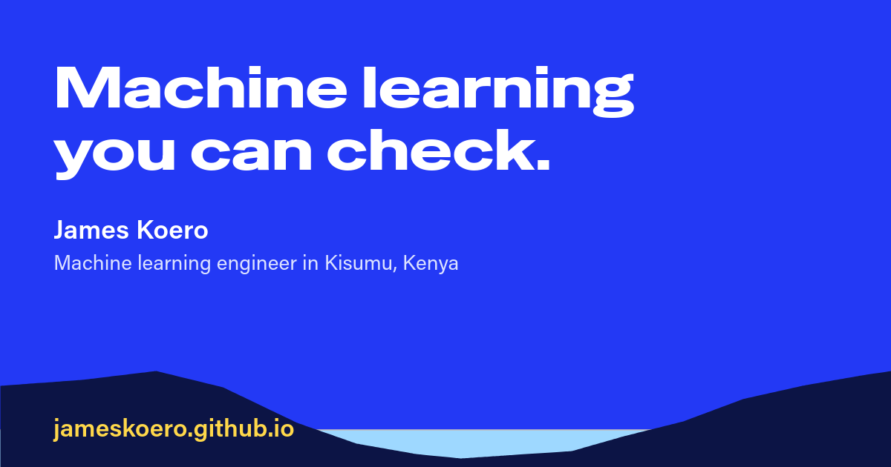

# James Koero: ML engineer portfolio

Personal portfolio of James Koero, an independent ML engineer in Kisumu, Kenya. I build flood-risk, salary and credit models end to end, write the protocol before the results, and report what did not work.

**Live site: https://jameskoero.github.io**

## What is on the site

| Page | Path |
|---|---|
| Home: work ledger with the Nyando interval plot, How I work, Path, Records, Tools, Contact | `/` |
| Case studies index | `/work/` |
| Case studies | `/work/nyando-flood-ai/`, `/work/afrisalaries/`, `/work/segmentiq/`, `/work/churchos/` |
| CV (HTML) | `/resume/` |
| Experience, Research, Skills, About, Contact | `/experience/`, `/research/`, `/skills/`, `/about/`, `/contact/` |
| Research reports | `/research/model-evaluation/`, `/research/onnx-validation/`, `/research/physics-constrained-ml/` |
| Writing | `/writing/`, `/writing/why-i-retracted-my-flood-model/` |
| Certifications | `/certifications/` |
| Not-found page | `404.html` |

CV downloads: `James_Koero_CV.pdf` (Machine Learning), `James_Koero_CV_MLOps.pdf`, `James_Koero_CV_LLM.pdf`.

The homepage valley illustration with a water-level slider is labelled as an illustration, not survey data.

## Selected work

- **Nyando Flood AI.** Flood susceptibility ranking for five wards of the Nyando basin, Kisumu County. Sentinel-1 flood labels, leave-one-event-out validation, and a monotonic gradient-boosting model served as ONNX behind FastAPI. The registered model beat an elevation-only baseline by +0.0384 per-event AUC (interval 0.0193 to 0.0611, 50 events), and the write-up reports where the advantage did not hold. Scores rank locations; they are not flood probabilities.
  [Code](https://github.com/jameskoero/nyando-flood-ai) | [Dashboard](https://nyando-flood-ai.vercel.app) | [Zenodo record](https://doi.org/10.5281/zenodo.23919053)
- **Loan Risk Assessment.** Loan default risk model with a Flask API. Cross-validated ROC-AUC 0.916 and held-out test ROC-AUC 0.791; both numbers are shown.
  [Code](https://github.com/jameskoero/loan-risk-assessment)
- **AfriSalaries.** Salary-band model and API for 8 African markets, trained on 1,526 real records. 59.5% band accuracy; two regression designs were tried and rejected.

Also on the site: ChurchOS (multi-tenant church-management SaaS, live at version 3.4.0), SegmentIQ (customer segmentation) and a Titanic baseline (hold-out ROC-AUC 0.8661). Every figure on the site comes from the linked repositories and records.

## How it is built

- Static HTML pages with inline CSS. No framework and no build step. The homepage project list is plain HTML, so it reads without JavaScript; the script only adds the Nyando interval plot, the theme toggle and the copy-email button.
- `scripts/check.py` checks banned wording, internal links and structure on every push (`.github/workflows/site-check.yml`), and external links weekly.
- `CLAIMS.md` records the source and check date of every figure on the site.
- Analytics: GoatCounter (code `jameskoero`), cookie-free. Every page loads it; CV downloads, GitHub, LinkedIn and email links are counted as click events (`data-goatcounter-click`). The contact page says so.
- Type: Special Gothic Expanded One and Instrument Sans. Palette: cobalt `#2339F5`, navy `#0C1445`, signal yellow `#FFD84A`, water `#9ED8FF`.
- `share-card.png` is the 1200 x 630 social preview image.
- Hosted on GitHub Pages from the `main` branch. Pushing a change republishes the site within a few minutes.
- To run it locally, use `python3 -m http.server 8000` in this folder and open http://localhost:8000.

## Contact

- Email: jmskoero@gmail.com
- LinkedIn: https://www.linkedin.com/in/jameskoero
- GitHub: https://github.com/jameskoero
- ORCID: https://orcid.org/0009-0001-8314-2682
